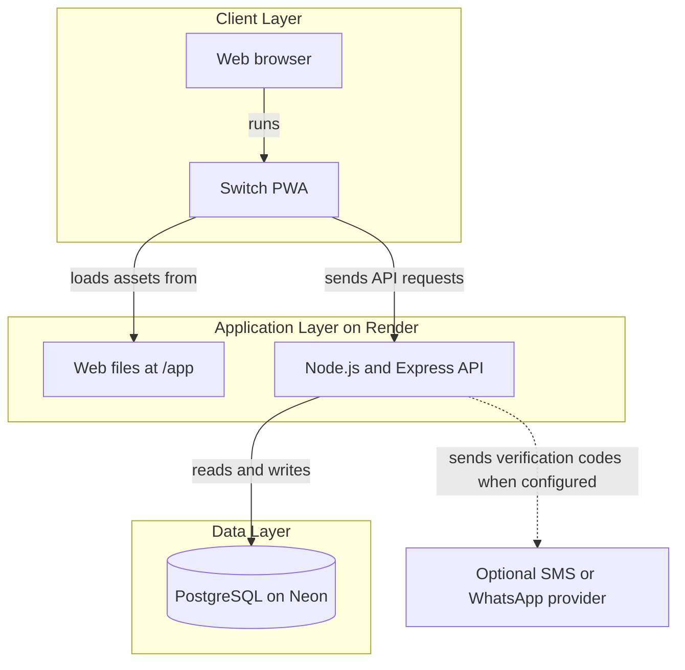

# Architecture Diagram

Switch is a progressive web application served with its REST API from one Node.js service. PostgreSQL stores application data, including the bytes of newly uploaded catalog images.

## Application Architecture

<!-- mermaid-checked: no \n, no em-dash/en-dash, no {} in labels, subgraphs are id["label"], arrows are -->|"label"|, all subgraphs closed by end, ids unique -->

### Technology Stack Summary

| Layer | Technology | Version | Purpose |
|---|---|---|---|
| Client | HTML, CSS, JavaScript ES modules | Browser-supported | PWA screens and interactions |
| Client | Service worker and web manifest | Browser-supported | Installable app and partial offline access |
| Application | Node.js | 20 | Runtime for the web server and API |
| Application | Express | 4.x | Serves the PWA and REST endpoints |
| Application | Multer | 2.x | Receives uploaded images in memory |
| Data access | node-postgres (`pg`) | 8.x | Executes PostgreSQL queries |
| Database | PostgreSQL | 14+ | Persists accounts, activity, moderation, and image bytes |
| Authentication | JWT and bcrypt | JWT 9.x, bcrypt 6.x | Authenticated sessions and password hashing |

### Data Storage & External Services

The deployed Render service hosts both the PWA (`/app`) and API (`/api`). Neon provides PostgreSQL storage. New catalog images are sanitized by the API and their bytes are stored in PostgreSQL, so they do not depend on Render's temporary filesystem. The OTP service can use a configured SMS or WhatsApp provider; local development can use the mock provider. Local development may connect to a local PostgreSQL database through environment configuration.

### Key Architectural Decisions

- The browser talks to the same Express service for the PWA and API in the deployed setup.
- Backend controllers coordinate domain services and SQL models; models use a shared PostgreSQL connection module.
- Catalog images are not made public until human moderation approves them and the related publication is active.

## Component Relationships

```mermaid
flowchart LR
    subgraph PresentationLayer["Presentation"]
        cPwa["Frontend PWA"]
        cApiClient["JavaScript API client"]
    end
    subgraph HttpLayer["HTTP Layer"]
        cServer["Express application"]
        cRoutes["API routes"]
        cMiddleware["Auth and error middleware"]
        cControllers["HTTP controllers"]
    end
    subgraph BusinessLayer["Business Logic"]
        cServices["Domain services"]
        cUtils["Shared utilities"]
    end
    subgraph DataAccessLayer["Data Access"]
        cModels["SQL models"]
        cDbConfig["PostgreSQL connection"]
    end
    subgraph StorageLayer["Storage"]
        cNeonDb[("PostgreSQL on Neon")]
    end

    cPwa -->|"uses"| cApiClient
    cApiClient -->|"sends HTTP requests"| cServer
    cServer -->|"mounts"| cRoutes
    cMiddleware -.->|"protects requests"| cRoutes
    cRoutes -->|"dispatches to"| cControllers
    cControllers -->|"uses when needed"| cServices
    cControllers -->|"reads and writes"| cModels
    cServices -->|"uses shared logic"| cUtils
    cServices -->|"uses when needed"| cModels
    cModels -->|"queries through"| cDbConfig
    cDbConfig -->|"connects to"| cNeonDb
```

<!-- mermaid-checked: no \n, no em-dash/en-dash, no {} in labels, subgraphs are id["label"], arrows are -->|"label"|, all subgraphs closed by end, ids unique -->

### Component Inventory

| Component | Layer | Type | Responsibility |
|---|---|---|---|
| Frontend PWA | Presentation | Web application | Renders screens and navigation |
| JavaScript API client | Presentation | HTTP client | Calls the backend and handles responses |
| Express application | HTTP | Server | Configures middleware and serves web files |
| API routes | HTTP | Router | Maps `/api` paths to controllers |
| Auth and error middleware | HTTP | Middleware | Validates sessions, permissions, and errors |
| HTTP controllers | HTTP | Controllers | Validates requests and coordinates operations |
| Domain services | Business Logic | Services | Implements authentication, OTP, and image moderation workflows |
| Shared utilities | Business Logic | Utilities | Provides classification, gamification, geography, and image helpers |
| SQL models | Data Access | Models | Reads and updates PostgreSQL records |
| PostgreSQL connection | Data Access | Configuration | Creates the shared database connection |
| PostgreSQL on Neon | Storage | Database | Persists application records and image bytes |
