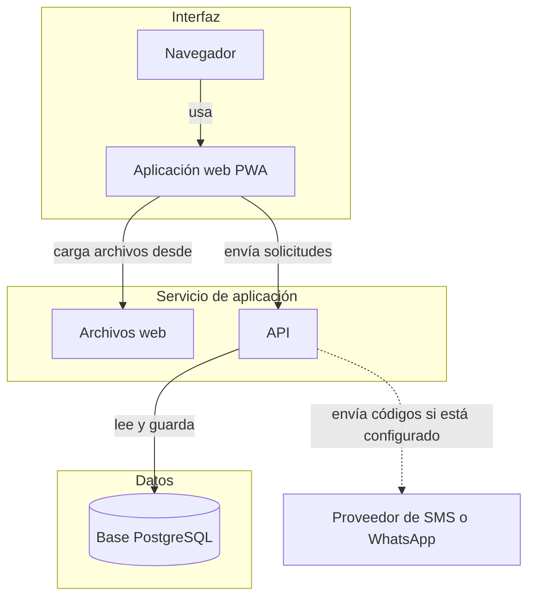

# Diagrama de arquitectura

Estas vistas resumen cómo se comunican las partes de Switch. Para conocer las tecnologías y el despliegue, consultá la sección correspondiente del [README](../../../../../README.md).

## Arquitectura de la aplicación

<!-- mermaid-checked: no \n, no em-dash/en-dash, no {} in labels, subgraphs are id["label"], arrows are -->|"label"|, all subgraphs closed by end, ids unique -->

## Relación entre componentes

```mermaid
flowchart LR
    subgraph PresentationLayer["Presentación"]
        cPwa["Interfaz PWA"]
        cApiClient["Cliente de API"]
    end
    subgraph HttpLayer["Capa HTTP"]
        cServer["Servidor web"]
        cRoutes["Rutas de API"]
        cMiddleware["Autenticación y errores"]
        cControllers["Controladores"]
    end
    subgraph BusinessLayer["Lógica de negocio"]
        cServices["Servicios"]
        cUtils["Utilidades"]
    end
    subgraph DataAccessLayer["Acceso a datos"]
        cModels["Modelos SQL"]
        cDbConfig["Conexión a PostgreSQL"]
    end
    subgraph StorageLayer["Almacenamiento"]
        cNeonDb[("Base PostgreSQL")]
    end

    cPwa -->|"usa"| cApiClient
    cApiClient -->|"envía solicitudes"| cServer
    cServer -->|"registra"| cRoutes
    cMiddleware -.->|"protege"| cRoutes
    cRoutes -->|"dirige a"| cControllers
    cControllers -->|"coordina"| cServices
    cControllers -->|"consulta o actualiza"| cModels
    cServices -->|"reutiliza"| cUtils
    cServices -->|"consulta o actualiza"| cModels
    cModels -->|"consulta mediante"| cDbConfig
    cDbConfig -->|"se conecta a"| cNeonDb
```

<!-- mermaid-checked: no \n, no em-dash/en-dash, no {} in labels, subgraphs are id["label"], arrows are -->|"label"|, all subgraphs closed by end, ids unique -->

### Componentes

| Componente | Capa | Tipo | Responsabilidad |
|---|---|---|---|
| Interfaz PWA | Presentación | Aplicación web | Muestra pantallas y navegación |
| Cliente de API | Presentación | Cliente HTTP | Envía solicitudes y procesa respuestas |
| Servidor web | HTTP | Servidor | Configura rutas y entrega archivos web |
| Rutas de API | HTTP | Enrutador | Asocia direcciones con controladores |
| Autenticación y errores | HTTP | Middleware | Comprueba sesión, permisos y errores |
| Controladores | HTTP | Controladores | Atienden solicitudes y coordinan operaciones |
| Servicios | Negocio | Servicios | Implementan flujos de autenticación, códigos e imágenes |
| Utilidades | Negocio | Funciones compartidas | Apoyan clasificación, gamificación y geolocalización |
| Modelos SQL | Datos | Modelos | Consultan y actualizan registros |
| Conexión a PostgreSQL | Datos | Configuración | Administra el acceso a la base |
