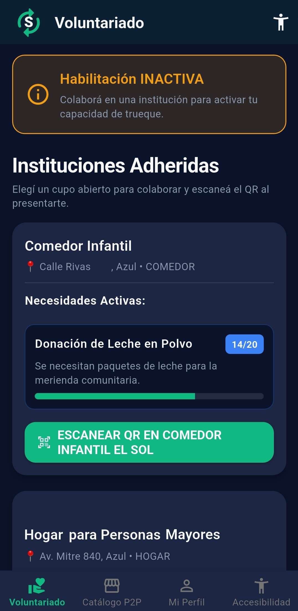
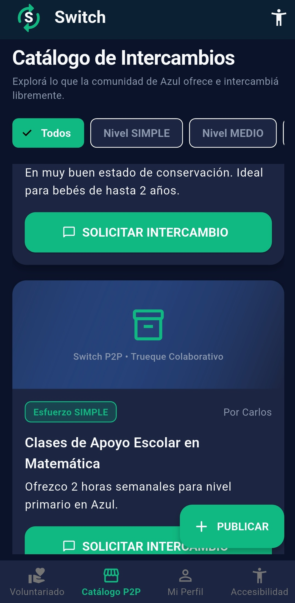
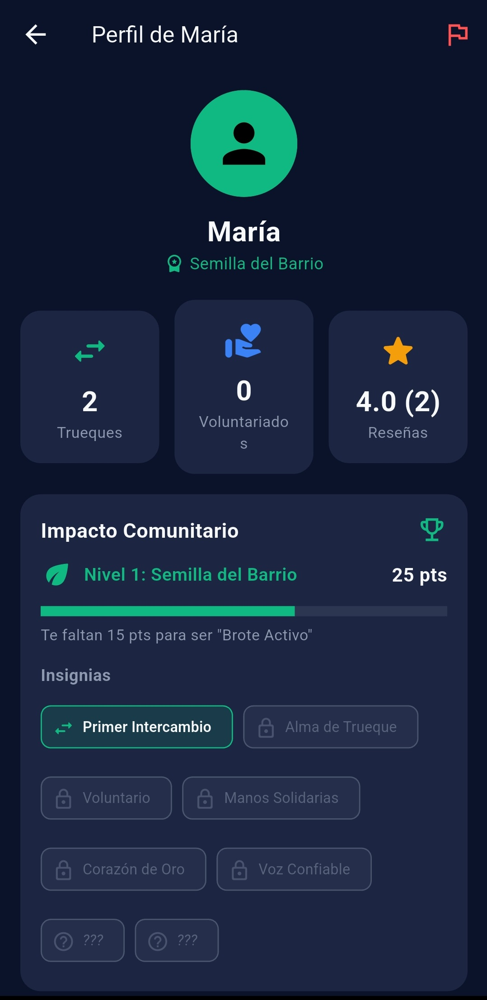
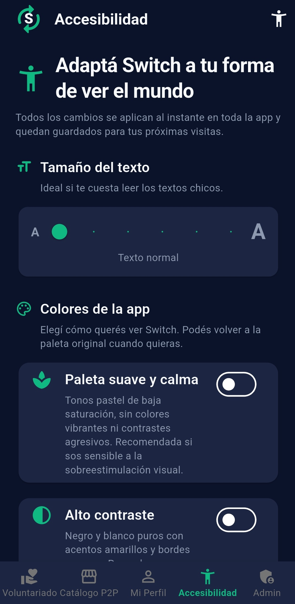
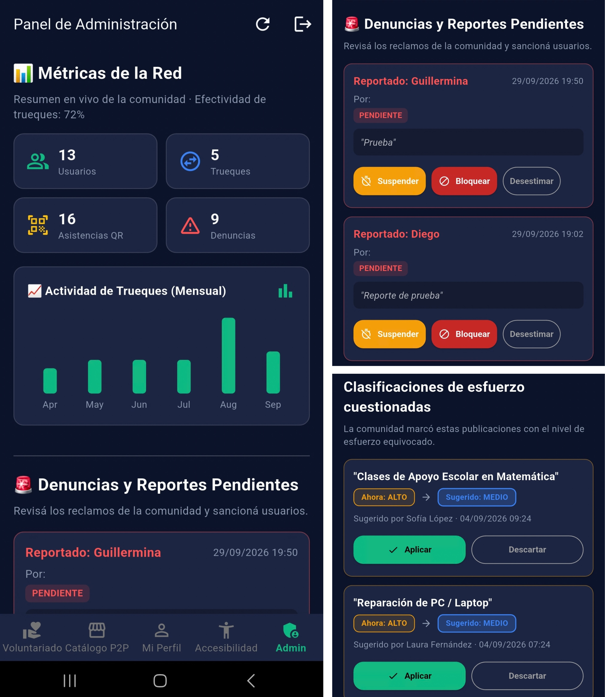
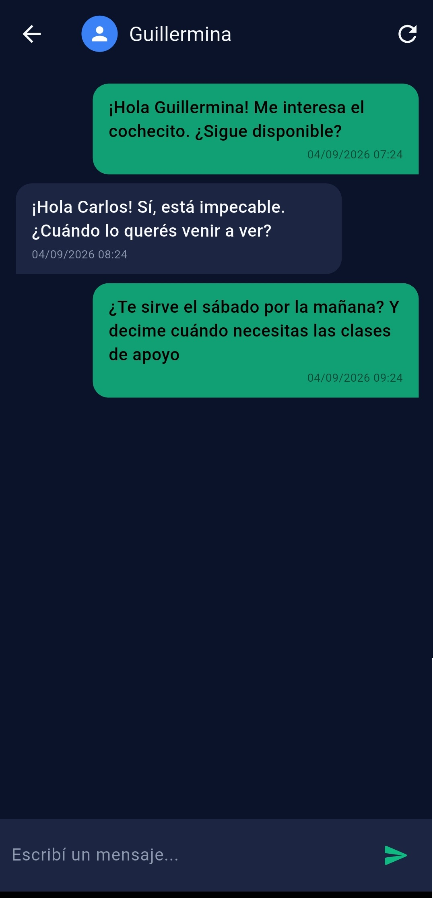

# Switch — Web (PWA de Trueques y Voluntariado Comunitario)

Switch es una plataforma que conecta a los vecinos de una ciudad con las instituciones comunitarias de su comunidad y les permite intercambiar objetos y servicios entre pares (P2P). La app premia la participación real: cada trueque completado o voluntariado verificado genera **Impacto Comunitario** (niveles, puntos e insignias) que mejora la reputación del vecino y la visibilidad de sus publicaciones.

Este repositorio contiene la **versión web progresiva (PWA)** de Switch, que se puede usar desde cualquier teléfono o navegador, sin instalar nada desde una tienda de aplicaciones.

<p align="center">
  
</p>

---

## 📸 Capturas

> Capturas ilustrativas de funcionalidades del proyecto; la interfaz web puede diferir.

| Voluntariado | Catálogo P2P | Perfil e insignias |
|:---:|:---:|:---:|
|  |  |  |

| Accesibilidad | Panel admin | Chat |
|:---:|:---:|:---:|
|  |  |  |

---

## Tecnologías

| Capa | Tecnología |
|---|---|
| Web (PWA) | HTML, CSS y JavaScript (ES Modules), sin dependencias externas |
| Backend | Node.js + Express (API REST) |
| Base de datos | PostgreSQL |
| Autenticación | JWT (JSON Web Tokens) + bcrypt |
| Imágenes | Multer en memoria durante la subida; bytes sanitizados en PostgreSQL |
| QR / Geolocalización | Lectura de QR en el navegador (`BarcodeDetector`) + `geolocation` |
| Despliegue actual | Aplicación web y API en **Render**, base de datos en **Neon** |

### Características de la PWA

- **Instalable**: se agrega a la pantalla de inicio del teléfono como una app (`manifest.webmanifest`).
- **Funciona offline (parcial)**: un service worker (`sw.js`) cachea la interfaz; las acciones que necesitan datos requieren conexión.
- **Accesibilidad**: 4 paletas (estándar, vista accesible, alto contraste y paleta suave), escala de texto, modo blanco y negro, navegación por teclado, foco visible y respeto por `prefers-reduced-motion`.
- **Sin CDN**: todos los recursos se sirven desde el propio proyecto.

---

## Funcionalidades principales

- **Voluntariado verificado**: las instituciones publican sus necesidades con prioridad (General / Prioritaria / Urgente). El vecino coordina por chat, se presenta y **escanea el QR físico de la institución** para activar su *Nexo Social*.
- **Vigencia inteligente del Nexo Social**: los días de validez se calculan según la urgencia de la necesidad, el esfuerzo estimado de la tarea y el nivel comunitario del voluntario.
- **Catálogo P2P**: publicación de objetos y servicios con **clasificación automática de esfuerzo**, búsqueda, filtros y propuestas de trueque multi-ítem.
- **Gamificación**: niveles de comunidad — *Semilla del Barrio → Brote Activo → Vecino Confiable → Motor Solidario → Pilar de la Comunidad* — con puntos e insignias, incluidas **insignias secretas**.
- **Chat integrado** entre vecinos y con instituciones, sistema de reportes y reseñas.
- **Panel de administración**: métricas de la red, moderación de publicaciones e imágenes, reportes (desestimar, suspender, dar de baja), buzón de contacto y sugerencias de esfuerzo.

---

## Estructura del proyecto

```
switchWeb/
├── frontend-web/              # Aplicación web progresiva (PWA)
│   ├── index.html             # Estructura base
│   ├── manifest.webmanifest   # Configuración de la PWA instalable
│   ├── sw.js                  # Service worker (cache / offline)
│   ├── css/                   # tema.css, componentes.css, pantallas.css
│   ├── icons/                 # Íconos de la app
│   └── js/
│       ├── app.js             # Arranque, armazón y navegación
│       ├── config.js          # URL del backend
│       ├── store.js           # Sesión y preferencias de accesibilidad
│       ├── api.js             # Cliente de la API REST
│       ├── ui.js              # Componentes e íconos
│       ├── router.js          # Enrutador por hash
│       └── screens/           # Pantallas (públicas y admin/)
├── backend/                   # API REST y servidor de la aplicación web
│   ├── src/
│   │   ├── config/            # Entorno, PostgreSQL y OTP
│   │   ├── controllers/       # Capa HTTP
│   │   ├── middlewares/       # JWT, errores, asyncWrapper
│   │   ├── models/            # Acceso a datos (SQL)
│   │   ├── routes/            # Endpoints /api
│   │   ├── services/          # Autenticación, OTP, moderación e imágenes
│   │   ├── utils/             # Gamificación, clasificador, geo, imágenes
│   │   └── content/           # Textos legales
│   ├── scripts/generarQrs.js
│   ├── test/
│   │   ├── *.test.js          # Pruebas unitarias
│   │   ├── fixtures/
│   │   └── integration-manual/ # Flujos que usan una base de datos
│   └── qrs_instituciones/     # PNG de los QR de presencia
├── docs/screenshots/          # Capturas usadas en el README
├── .env.example               # Plantilla de variables de entorno
├── schema.sql                 # DDL completo (14 tablas)
├── seed.sql                   # Datos de ejemplo
└── diagramas_mermaid_srs.md   # UML del sistema
```

El backend sirve la PWA en `/app/`, por lo que la aplicación web y la API pueden publicarse juntas en un único servicio.

---

## Puesta en marcha (desarrollo local)

### Requisitos

- Node.js 20
- PostgreSQL 14+ (local, o una base en Neon)

### 1. Base de datos

Con PostgreSQL local:

```bash
psql -U postgres -c "CREATE DATABASE switch_db;"
psql -U postgres -d switch_db -f schema.sql
psql -U postgres -d switch_db -f seed.sql
```

En Neon, ejecutá `schema.sql` desde el editor SQL. Usá `seed.sql` sólo en una base descartable para cargar datos de demostración: vacía las tablas antes de insertar los ejemplos.

### 2. Backend

```bash
cd backend
npm install
npm run dev     # o: npm start
```

En local, copiá `.env.example` como `.env` en la raíz del repositorio y completá los datos de tu PostgreSQL local. En Render, configurá las variables del servicio con los datos de Neon (`DB_HOST`, `DB_USER`, `DB_PASSWORD`, `DB_NAME`, `DB_PORT`) o usá `DATABASE_URL`. El backend detecta Render y no carga el `.env` local.

```env
PORT=3000
DB_USER=postgres
DB_PASSWORD=
DB_HOST=localhost
DB_PORT=5432
DB_NAME=switch_db
DB_SSL=false
# Alternativa: DATABASE_URL con la cadena de conexión de PostgreSQL
JWT_SECRET=una_clave_larga_y_secreta
OTP_PROVEEDOR=MOCK
OTP_HMAC_SECRET=una_clave_larga_para_otp
GPS_VALIDACION_ACTIVA=false
ORIGENES_PERMITIDOS=       # opcional; restringe CORS si la web se sirve desde otro origen
```

La opción **Recuperarla** permite cambiar la contraseña mediante un código enviado al teléfono registrado. Para enviar códigos reales, configurá un proveedor de SMS o WhatsApp y una clave `OTP_HMAC_SECRET` secreta. `MOCK` es para desarrollo local. Los cambios necesarios de base de datos están incluidos en `schema.sql`.

### 3. Web

Con el backend corriendo en el puerto 3000, la web se sirve en:

```
http://localhost:3000/app/
```

También se puede abrir `frontend-web/index.html` con un servidor estático (Live Server, etc.); en ese caso la web apunta sola al backend en el puerto 3000 del mismo host.

### 4. Códigos QR de las instituciones

```bash
cd backend
node scripts/generarQrs.js   # guarda los PNG en backend/qrs_instituciones/
```

### 5. Pruebas

Desde `backend`, ejecutá `npm test` para correr las pruebas unitarias. Las pruebas de integración que están en `test/integration-manual/` no forman parte de ese comando: usan una base de datos y deben ejecutarse sólo contra una base local descartable, nunca contra producción.

---

## Despliegue

La web y la API comparten el servicio de Render; Neon aloja la base PostgreSQL persistente.

### 1. Base de datos (Neon)

1. Crear un proyecto en [neon.tech](https://neon.tech) y copiar la cadena de conexión.
2. En el **SQL Editor**, ejecutar `schema.sql`. Incluye la estructura y las actualizaciones; se puede volver a ejecutar sobre una base existente sin borrar sus datos.
3. Ejecutar `seed.sql` sólo en una base descartable para cargar datos de demostración. Este archivo vacía las tablas antes de insertar los ejemplos.

### 2. Backend (Render)

1. Crear un **Web Service** apuntando a este repositorio.
2. **Root Directory:** `backend`
3. **Build Command:** `npm install`  ·  **Start Command:** `npm start`
4. Cargar las variables de entorno de Neon y las claves secretas de la aplicación.

Las imágenes nuevas se guardan como bytes en Neon para que persistan entre reinicios y despliegues, sin depender de un disco persistente en Render. Quedan pendientes de revisión y sólo se muestran en el catálogo después de que una persona administradora las aprueba. Las imágenes anteriores no se recuperan si el almacenamiento temporal donde estaban ya fue eliminado. Las imágenes nuevas consumen espacio de la base de datos.

## Usuarios de prueba

Las siguientes cuentas se crean al ejecutar `seed.sql`. Usalas sólo en una base de pruebas; ese archivo vacía las tablas antes de cargar los datos.

| Rol / caso de prueba | DNI | Nombre | Contraseña |
|---|---|---|---|
| Vecina con Nexo activo y publicaciones | `38450912` | Guillermina Valdez | `clave123` |
| Vecino | `35123456` | Carlos Rodríguez | `clave123` |
| Delegada | `28999888` | María Gómez | `clave123` |
| Administrador | `11111111` | Admin Switch | `Switch2024!` |
| Vecina | `31222444` | Laura Fernández | `clave123` |
| Vecino | `27333455` | Diego Martínez | `clave123` |
| Delegada | `29888777` | Sofía López | `clave123` |
| Vecino | `33555666` | Martín Pérez | `clave123` |
| Vecina | `34119988` | Valentina Sosa | `clave123` |
| Vecino | `30888999` | Joaquín Romero | `clave123` |
| Vecina | `35555667` | Camila Díaz | `clave123` |
| Delegado | `31888999` | Nicolás Álvarez | `clave123` |
| Vecina con suspensión vigente | `80990011` | Lucía Penalizada | `clave123` |
| Cuenta bloqueada (no puede iniciar sesión) | `80990022` | Pedro Bloqueado | `clave123` |
| Vecina con penalización vencida | `80990033` | Ana Vencida | `clave123` |

La cuenta administradora permite probar el panel; las cuentas Lucía, Pedro y Ana sirven para verificar los distintos estados de bloqueo y penalización.

---

## Documentación adicional

- [Diagramas del sistema](diagramas_mermaid_srs.md): vista general, flujo de publicación con imagen y relaciones principales de datos.
- [Diagrama de arquitectura](.github/modernize/assessment/engines/facts/architecture-diagram.md): capas de la aplicación y relaciones entre componentes.
