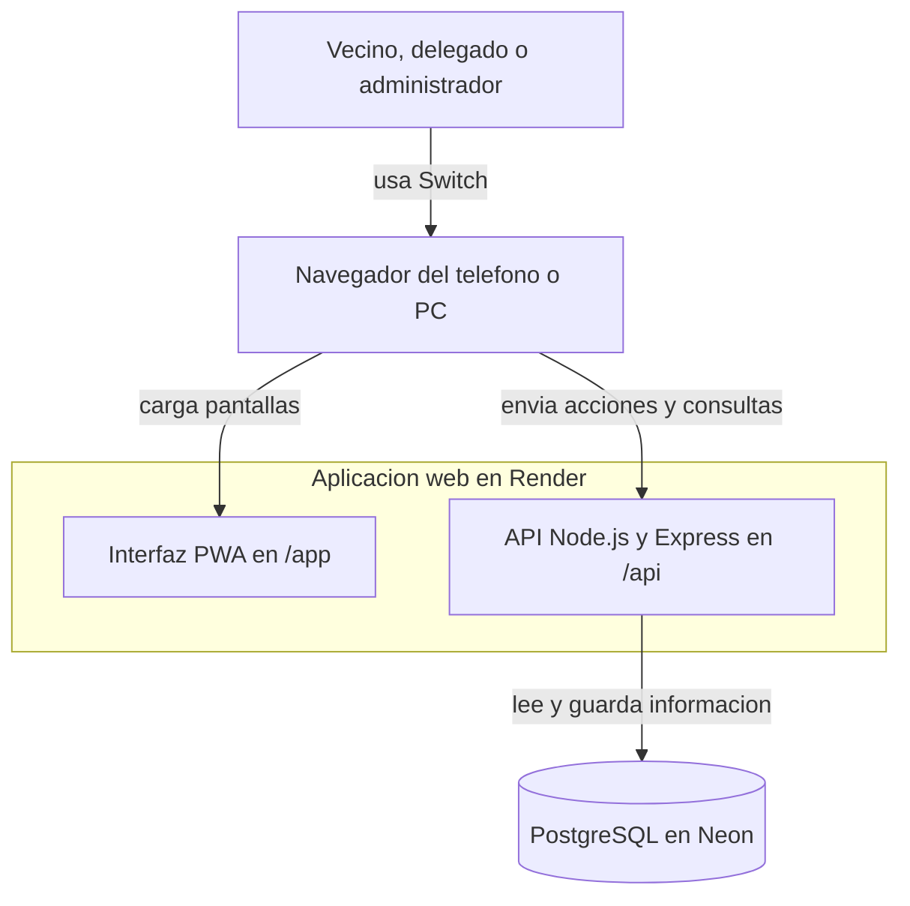
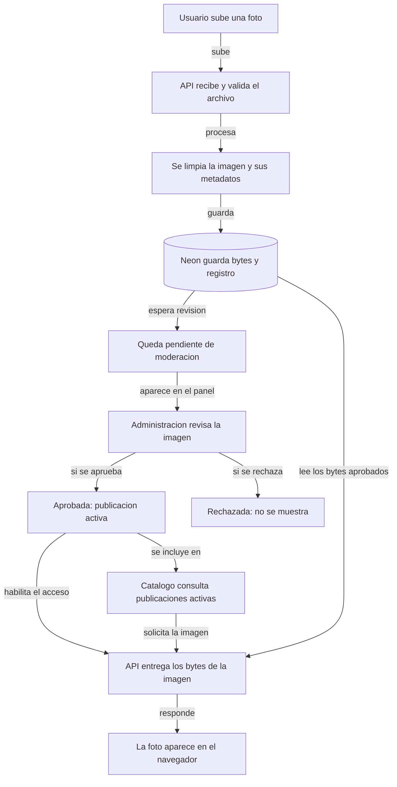
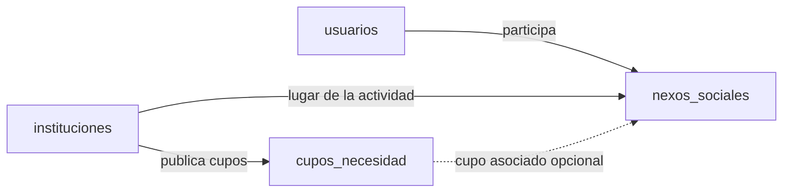
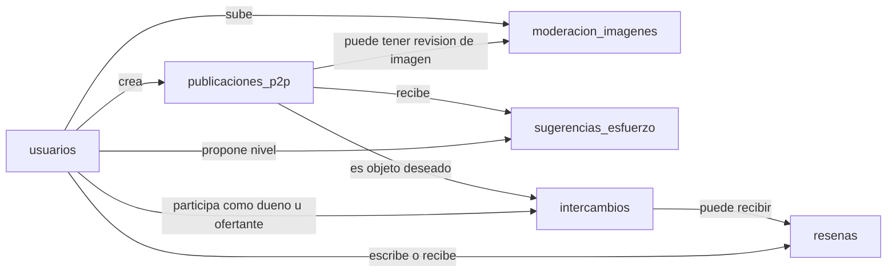
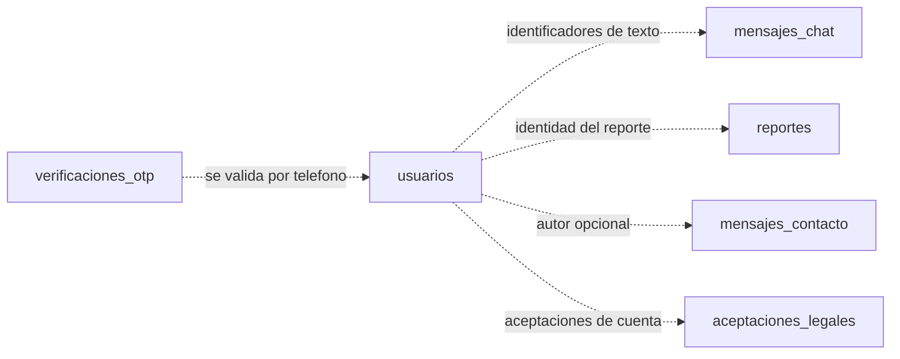

# Diagramas del sistema Switch

Estos diagramas muestran el sistema actual en palabras simples. Cada uno explica una parte distinta: dónde se ejecuta la app, qué pasa con una foto y cómo se conectan los datos principales. No hace falta conocer el código para leerlos.

## 1. Dónde funciona la aplicación

La persona usa Switch desde el navegador. Render entrega la web y la API; la API consulta y guarda los datos en PostgreSQL alojado en Neon.

<!-- mermaid-checked: no \n, no em-dash/en-dash, no {} in labels, subgraphs are id["label"], arrows are -->|"label"|, all subgraphs closed by end, ids unique -->

**Cómo leerlo:** la PWA es la parte visual; la API procesa las acciones. Ambas se publican en Render y la información persistente vive en Neon. En desarrollo local, el backend puede usar PostgreSQL local según la configuración del entorno.

## 2. Qué ocurre cuando se sube una foto

Este recorrido explica por qué una foto nueva no aparece inmediatamente: antes debe revisarla una persona administradora.

<!-- mermaid-checked: no \n, no em-dash/en-dash, no {} in labels, subgraphs are id["label"], arrows are -->|"label"|, all subgraphs closed by end, ids unique -->

**Importante:** las imágenes nuevas persisten en Neon y no dependen del disco temporal de Render. Las imágenes que sólo existían en un disco efímero y se perdieron no pueden recuperarse desde la aplicación.

## 3. Datos de comunidad y voluntariado

Una institución publica cupos de necesidad. La participación de una persona en uno de esos cupos queda registrada como un Nexo Social.

<!-- mermaid-checked: no \n, no em-dash/en-dash, no {} in labels, subgraphs are id["label"], arrows are -->|"label"|, all subgraphs closed by end, ids unique -->

La línea punteada indica que `cupo_necesidad_id` puede quedar vacío en un Nexo Social.

## 4. Publicaciones e intercambios

Las publicaciones pertenecen a usuarios. Las propuestas de intercambio conectan una publicación deseada con las personas involucradas; después de completar el intercambio se pueden guardar reseñas.

<!-- mermaid-checked: no \n, no em-dash/en-dash, no {} in labels, subgraphs are id["label"], arrows are -->|"label"|, all subgraphs closed by end, ids unique -->

## 5. Registros de soporte

Estos datos acompañan las funciones principales. Algunos registros se relacionan por identificadores de texto, no por claves foráneas.

<!-- mermaid-checked: no \n, no em-dash/en-dash, no {} in labels, subgraphs are id["label"], arrows are -->|"label"|, all subgraphs closed by end, ids unique -->

En `mensajes_chat` y `reportes`, las identidades se guardan como texto y no tienen una clave foránea directa a `usuarios`. `mensajes_contacto` y `aceptaciones_legales` sí permiten guardar registros sin un usuario asociado.
