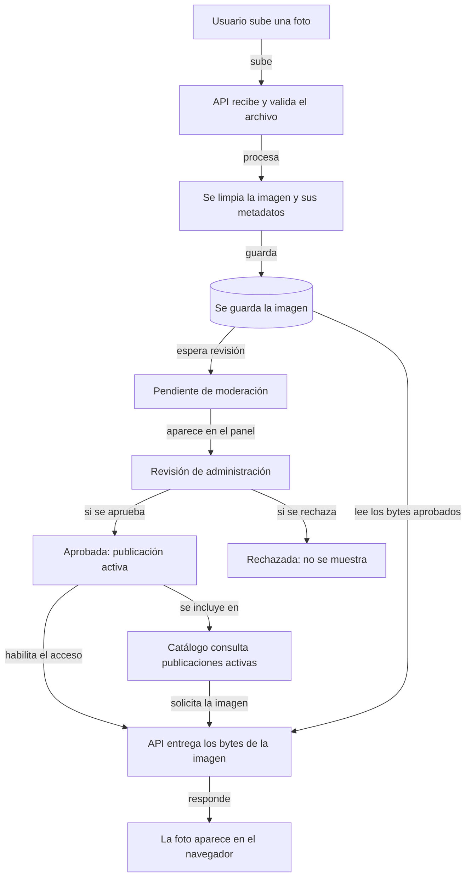
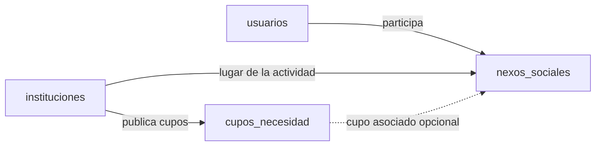
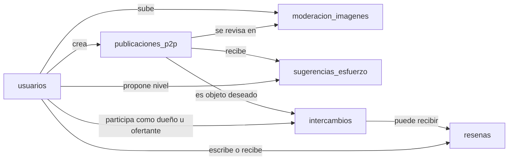

# Diagramas del sistema Switch

Estos diagramas complementan la descripción y las tecnologías del [README](README.md): muestran el flujo de moderación de imágenes y las relaciones entre los datos.

## 1. Qué ocurre cuando se sube una foto

<!-- mermaid-checked: no \n, no em-dash/en-dash, no {} in labels, subgraphs are id["label"], arrows are -->|"label"|, all subgraphs closed by end, ids unique -->

## 2. Datos de comunidad y voluntariado

<!-- mermaid-checked: no \n, no em-dash/en-dash, no {} in labels, subgraphs are id["label"], arrows are -->|"label"|, all subgraphs closed by end, ids unique -->

La línea punteada indica que `cupo_necesidad_id` puede quedar vacío en un Nexo Social.

## 3. Publicaciones e intercambios

<!-- mermaid-checked: no \n, no em-dash/en-dash, no {} in labels, subgraphs are id["label"], arrows are -->|"label"|, all subgraphs closed by end, ids unique -->

## 4. Registros de soporte

<!-- mermaid-checked: no \n, no em-dash/en-dash, no {} in labels, subgraphs are id["label"], arrows are -->|"label"|, all subgraphs closed by end, ids unique -->

Las líneas punteadas indican relaciones indirectas o asociaciones opcionales.
